 

# Pokédex

### A little place to explore Pokémon.

[**Open Website**](https://prawaldev.github.io/Pokedex) · [**Download Android APK**](https://github.com/Prawaldev/Pokedex/releases/latest) · [**View Releases**](https://github.com/Prawaldev/Pokedex/releases)

---

## About

Pokédex is a Pokémon exploration app with a clean interface for browsing Pokémon, discovering their details, and searching for Pokémon based on what you remember about them.

Available as a website and an Android app.

## Get Pokédex

| Platform | Link |
|:---:|:---|
| **Web** | [Launch Pokédex](https://prawaldev.github.io/Pokedex) |
| **Android** | [Download the latest APK](https://github.com/Prawaldev/Pokedex/releases/latest) |

**Android installation:** Download the APK from the latest release, open it on your Android device, and allow installation from that source if prompted.

> Note: Android installation may require allowing apps from your browser or file manager. The APK is distributed through GitHub Releases, not the Google Play Store.

---

## Screenshots

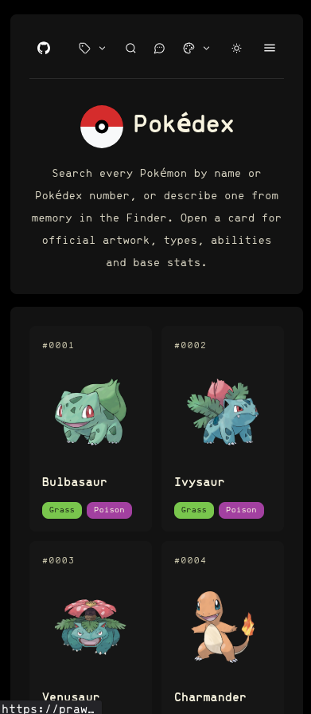
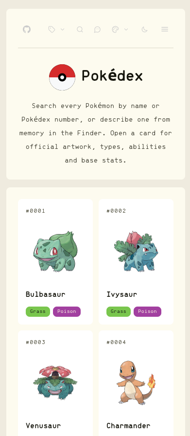
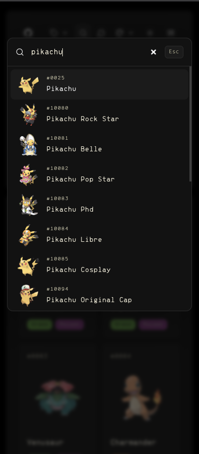
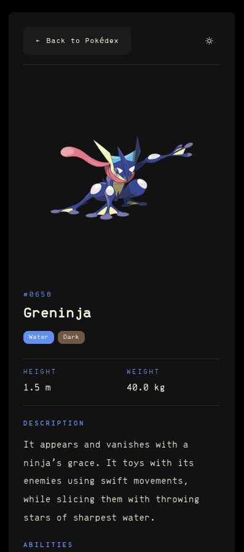
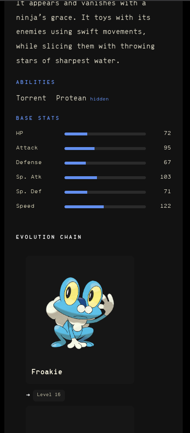
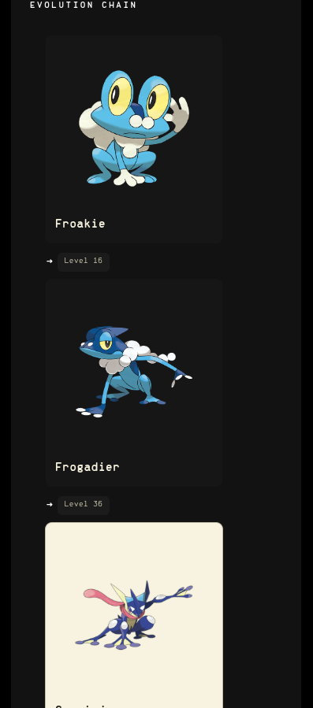
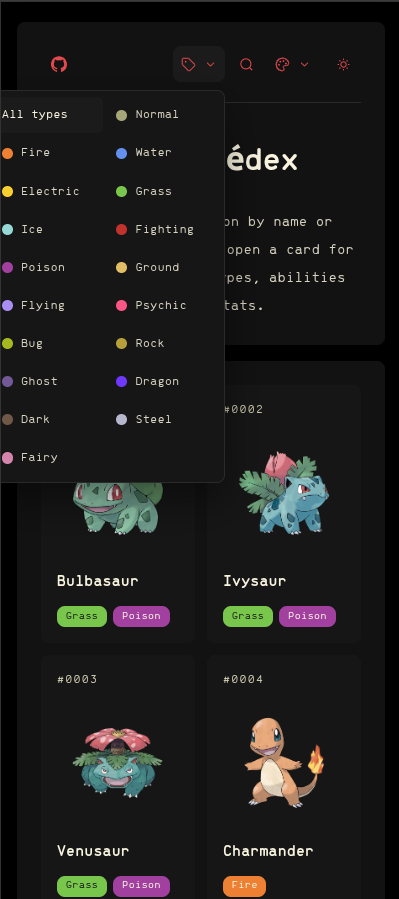

---

## Features

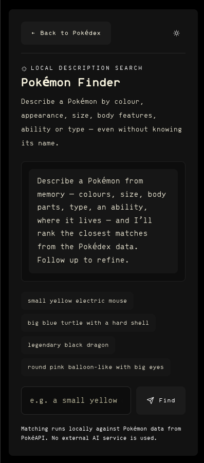
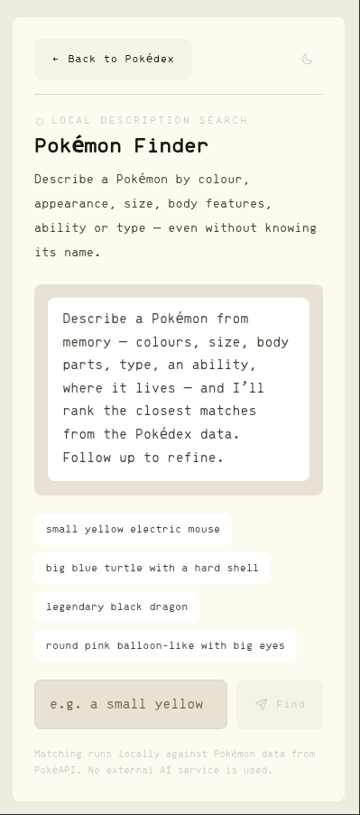
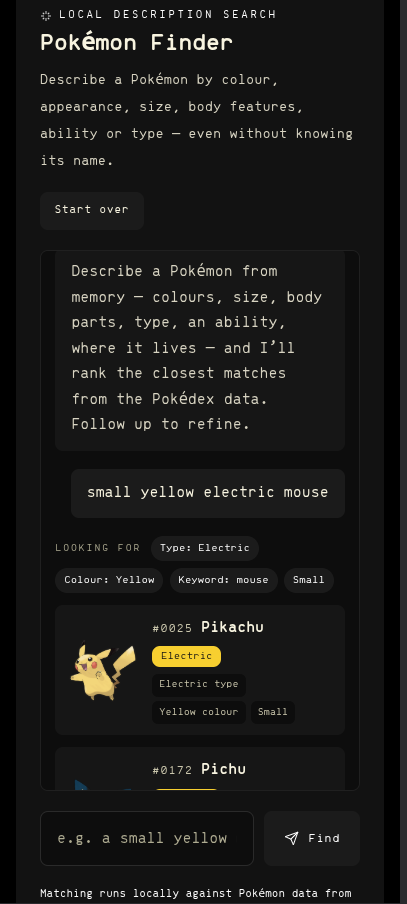
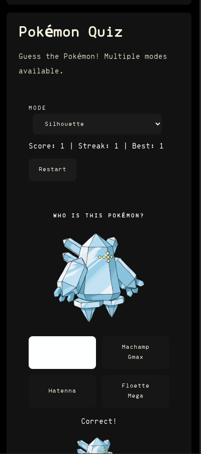

---

Made for Pokémon fans.

