= 

# Pokédex

### A little place to explore Pokémon.

---

## About

Pokédex is a Pokémon exploration app with a clean interface for browsing Pokémon, discovering their details, and searching for Pokémon based on what you remember about them.

Available as a website and an Android app.

## Get Pokédex

| Platform | Link |
|:---:|:---|
| **Web** | [Launch Pokédex](https://prawaldev.github.io/Pokedex) |
| **Android** | [Download the latest APK](https://github.com/Prawaldev/Pokedex/releases/latest) |
| **Releases** | [View all releases](https://github.com/Prawaldev/Pokedex/releases) |

> [!IMPORTANT]
> Android installation may require allowing apps from your browser or file manager. The APK is distributed through GitHub Releases, not the Google Play Store.

---

## Screenshots

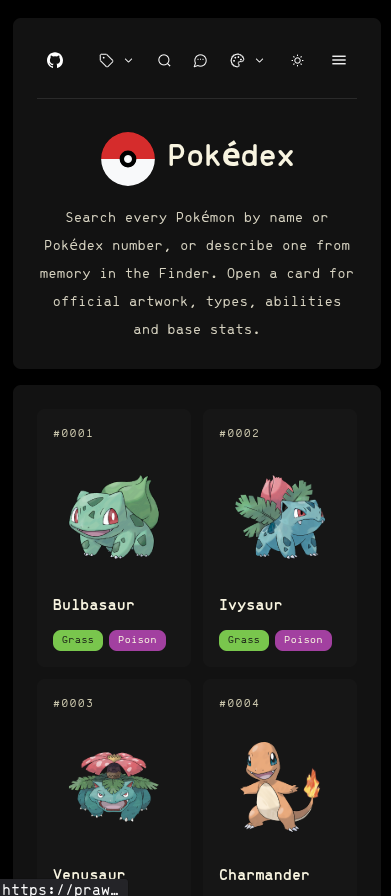
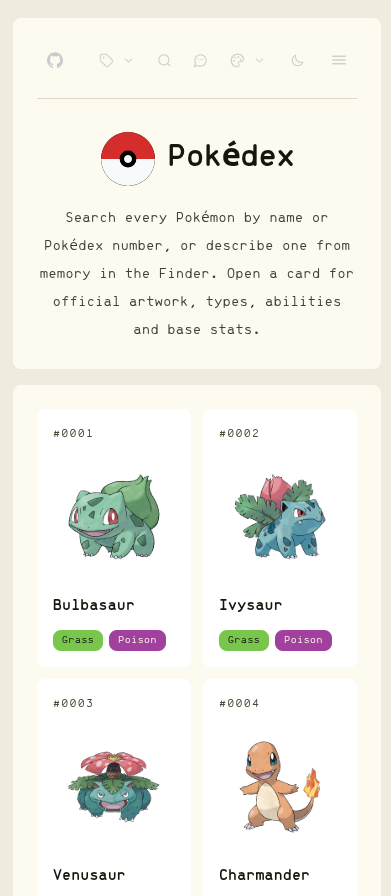
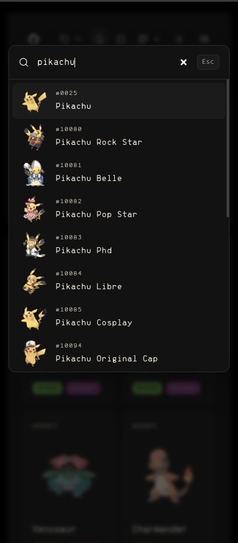
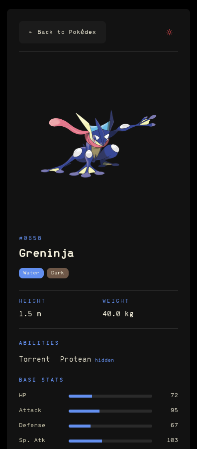
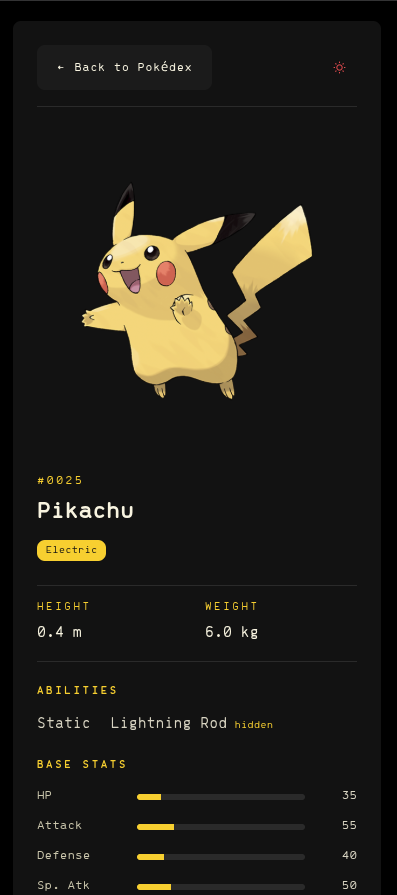
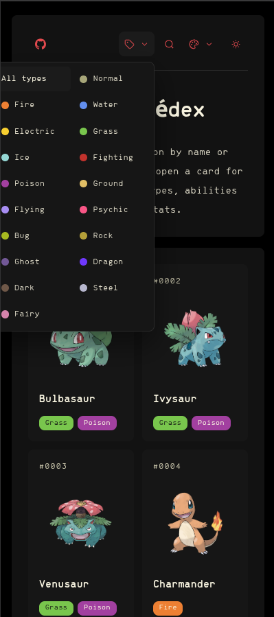
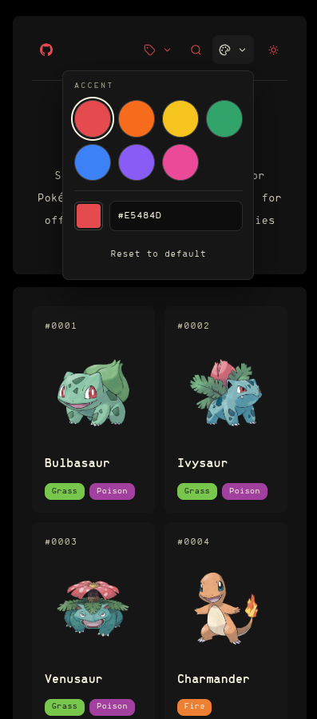

---

## Features

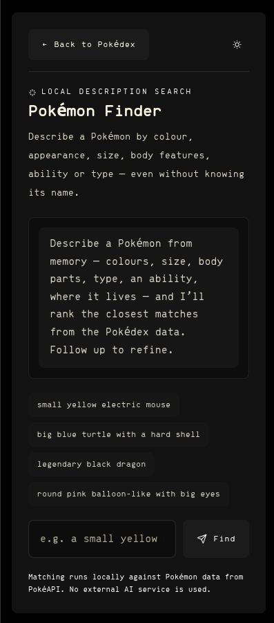
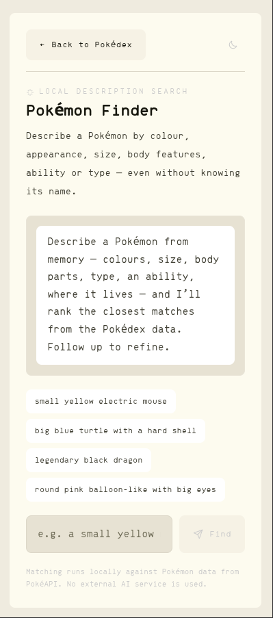
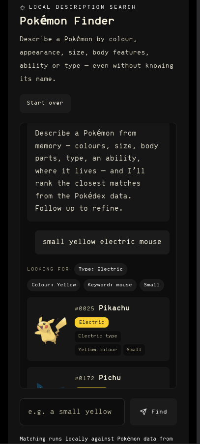
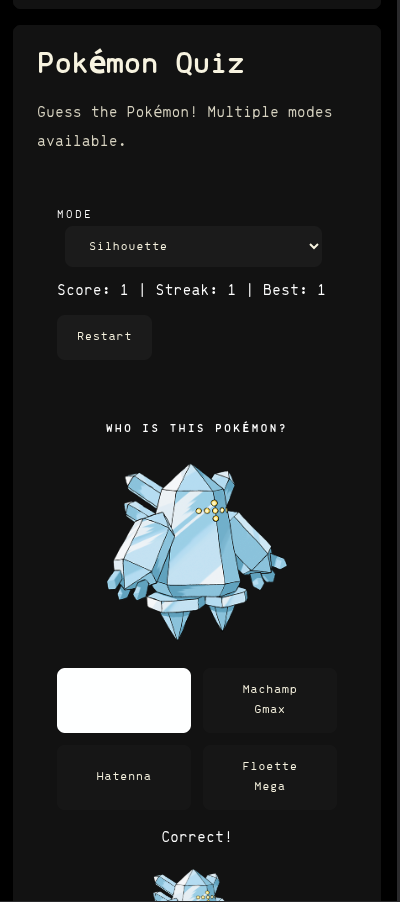

--

## License

> [!NOTE]
> This project is licensed under the **MIT License**. See the [LICENSE](LICENSE) file for details.
>
> Pokémon-related names, characters, artwork, and data belong to their respective owners and are not covered by this project's MIT License.

---

Made for Pokémon fans.

